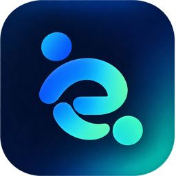

# Duely

**Proof of work. Peace of mind. Pay on time.**

🏆 **Winner, "Why Not?" Track · NYC XRP Hackathon 2026 · $4,000 team prize**

## 💡 What is Duely?

Freelancers shouldn't have to wait weeks to get paid for work they've already completed. But clients shouldn't have to risk paying for work that doesn't meet expectations, either.

**Duely bridges that trust gap with AI-powered verification, blockchain-backed escrow, and a liquidity pool that makes early payments possible.**

Clients lock funds in escrow and establish clear acceptance criteria upfront. Freelancers submit proof of their work, which Google Gemini evaluates against those requirements. Once verified, freelancers can request an early payment funded by Duely's liquidity pool, without waiting for final client approval.

Here's where it gets interesting: **when the client approves the completed work, the escrowed funds are released to repay the liquidity pool**, replenishing the capital used to advance the freelancer's payment. A small service fee supports the platform and provides yield to liquidity providers (LPs), creating an incentive to keep the pool funded.

Built on the **XRPL EVM testnet**, Duely brings freelancers, clients, and liquidity providers together in a payment system designed around trust, transparency, and faster access to earnings.

**Prove the work. Unlock the pay.**

## ✨ Key features

- 📝 AI-assisted drafting of requirements and acceptance criteria
- 🤖 Gemini-powered evaluation of submitted work (the server computes the score, not the AI)
- ⛓️ Escrow and early-payment workflows on the XRPL EVM testnet
- 👥 Client and freelancer dashboards (plus an operator view)
- 📎 Evidence submission via files or GitHub commits

## 🛠️ Tech stack

Next.js · React · TypeScript · Tailwind CSS · Google Gemini API · Supabase · XRPL EVM (Solidity, viem)

Built with the help of **Claude Code** and **ChatGPT**.

## 📸 Demo

<!-- TODO: add 2-3 screenshots (e.g. invoice creation, evidence evaluation, payment timeline) -->
_Coming soon._

## 👩‍💻 Team

Built by a team of 3:

- Zahin Tasnin | zt276@cornell.edu | [Zahin's LinkedIn](https://www.linkedin.com/in/zahintasnin/)
- Caedy Lee | cl2727@cornell.edu | [Caedy's LinkedIn](https://www.linkedin.com/in/caedy-lee/)
- Paula Hirsch | ph484@cornell.edu | [Paula's LinkedIn](https://www.linkedin.com/in/paula-hirsch/)

<!-- TODO: add GitHub profile links -->
