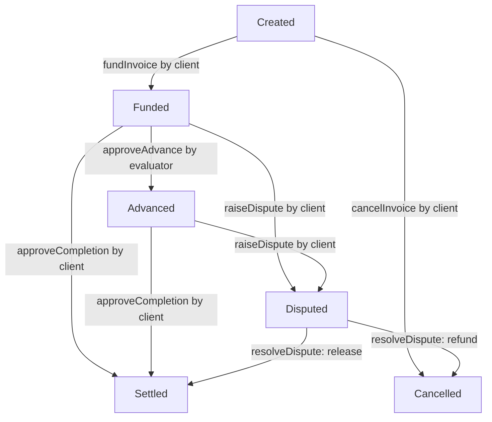

# Duely MVP — Smart Contract Specification

**File:** `docs/CONTRACT_SPEC.md`  
**Version:** 1.1 (MVP-aligned interface proposal; freeze jointly before implementation)  
**Owner:** Track A — Blockchain & Contracts  
**Target:** XRPL EVM Testnet · Solidity · Foundry · OpenZeppelin · viem

> **Instruction to Claude Code:** This document is the source of truth for the on-chain financial model. Implement exactly these externally observable behaviors. Do not change public interfaces, role permissions, status transitions, or accounting semantics without first flagging the proposed change. Prefer minimal, audited OpenZeppelin components. Do not implement the AI evaluator, file storage, HTTP endpoints, wallet abstraction, or external lending vaults in Solidity.

## Integration decisions to freeze with Track B

- **Invoice origin:** client creates the agreement on-chain; freelancer is the specified recipient. Freelancer acceptance is off-chain for the MVP.
- **Funding:** client approves ERC-20 spending, then calls `fundInvoice`. The platform separately deposits reserve tokens.
- **Submission / evaluation:** off-chain only; the evaluator signer submits `approveAdvance` only after an authenticated freelancer request and a persisted passing evaluation.
- **Final approval:** client wallet calls `approveCompletion`; disputed invoices require trusted operator resolution.
- **One token per deployment:** each `InvoiceAdvance` has one immutable ERC-20. Two deployments exist on XRPL EVM testnet: dUSD (mock, 6 decimals) and RLUSD (`0x27b57a9D0b8d24EB97259c4E2279e45255e016f3`, 18 decimals, verified live in A6.6.4b). Do not label a mock as RLUSD, or RLUSD as a demo token. Unlike dUSD, RLUSD is issuer-controlled: the issuer can pause (funding, advances and settlement then revert until unpaused), claw back (which can leave the contract undercollateralised) and upgrade it. The contract cannot mitigate this.
- **Interface freeze:** Track B must agree to the `createInvoice(freelancer, amount, metadataHash)` signature, event fields, enum order, metadata hashing procedure, and contract address before parallel integration.

## 1. Scope and financial model

Duely advances **90% of a fully client-funded invoice** to a freelancer after an authorized off-chain AI evaluation. The advance comes from an operator-funded reserve, **not** from the client's escrow. When the client accepts completion, escrow repays the reserve for the advance and pays the remaining 10% to the freelancer.

**Explicit MVP assumptions**

- One immutable ERC-20 payment token selected at deployment (dUSD mock, 6 decimals, or RLUSD, 18 decimals, on testnet). All logic is decimals-agnostic integer base-unit math, so the 90% advance is identical at both.
- One contract holds all invoice escrow and reserve tokens, but maintains separate accounting.
- Full client pre-funding is mandatory before any advance; no partial funding or installment payments.
- Exactly one advance per invoice, fixed at `floor(amount * 9000 / 10000)` in token base units.
- The operator initially supplies all reserve liquidity; no third-party depositor shares, interest, fees, yield, or external lending protocol.
- An authorized evaluator signer approves an advance only after the backend verifies a passing AI evaluation **and an explicit authenticated freelancer advance request**; the contract does **not** independently verify AI quality.
- The client, not the AI evaluator, approves final completion and ordinary settlement.
- A dispute freezes ordinary advance/settlement; an operator may resolve it through one of the specified outcomes.
- No ability to claw back funds already paid to the freelancer. A client refund after an advance crystallizes an operator reserve loss.
- No upgradeable proxy, oracle, interest accrual, deadline, gas sponsorship, or automatic dispute arbitration in the MVP.

### Worked example (6-decimal token)

| Step | Reserve | Escrow | Freelancer cumulative receipts |
|---|---:|---:|---:|
| Initial (after operator deposits) | 10,000 | 0 | 0 |
| Client funds invoice | 10,000 | 1,000 | 0 |
| Evaluator approves 90% advance | 9,100 | 1,000 | 900 |
| Client approves completion | 10,000 | 0 | 1,000 |

All displayed amounts are token units; Solidity operates in integer base units. The advance is not a transfer out of client escrow.

## 2. Roles and trust boundaries

| Role | Identity | Permissions |
|---|---|---|
| `DEFAULT_ADMIN_ROLE` | Multisig/operator wallet for MVP | Grant/revoke `EVALUATOR_ROLE`, administer operator role; do not bypass invoice states |
| `OPERATOR_ROLE` | Operator wallet | Deposit/withdraw reserve, resolve disputes |
| `EVALUATOR_ROLE` | Backend-held signer | Approve advance for a funded invoice only |
| Freelancer | Invoice's `freelancer` address | Submit evidence and request an advance off-chain; read invoice; receive payments |
| Client | Invoice's `client` address | Create and fund invoice, approve completion, raise dispute |
| Public | Any caller | Read public invoice/reserve state and events |

- `createInvoice` must set `client = msg.sender` (no impersonation).
- The caller supplies `freelancer`, `amount`, and `metadataHash`; `freelancer != address(0)` and `freelancer != client`.
- The freelancer must accept the invoice through the authenticated off-chain product workflow before submitting work; this MVP does not enforce an on-chain acceptance signature.
- `EVALUATOR_ROLE` signer must **never** be exposed to the browser; Track B must not create a second independent signing flow.
- The backend must authenticate requesters, verify the freelancer explicitly requested an advance, and persist AI evaluation records. An `evaluationHash` is an audit commitment, **not** cryptographic proof of AI correctness.
- All role and invoice-specific checks must be enforced on-chain even if also checked in the backend.

## 3. Contract data model

Use Solidity `^0.8.24` (or the repo's pinned compatible compiler) and OpenZeppelin `AccessControl`, `SafeERC20`, `ReentrancyGuard`.

```solidity
enum InvoiceStatus {
    Created,   // 0: invoice exists, not funded
    Funded,    // 1: escrow holds entire invoice amount
    Advanced,  // 2: reserve-funded advance paid
    Settled,   // 3: final payout complete
    Disputed,  // 4: frozen pending operator resolution
    Cancelled  // 5: escrow refunded, or unfunded invoice cancelled
}

struct Invoice {
    address freelancer;
    address client;
    uint256 amount;
    uint256 advanceAmount; // zero until paid; remains recorded thereafter
    bytes32 metadataHash;
    bytes32 evaluationHash; // zero until advance; remains recorded thereafter
    InvoiceStatus status;
}
```

State variables (names are normative for clarity):

```solidity
IERC20 public immutable paymentToken;
uint256 public nextInvoiceId;       // starts at 1
uint256 public reserveBalance;      // available reserve owned by operator
uint256 public totalEscrow;         // sum of funded invoice escrow liabilities
mapping(uint256 => Invoice) private invoices;
```

- `nextInvoiceId` starts at 1; `0` is invalid.
- `amount`, `advanceAmount`, `reserveBalance`, `totalEscrow` are integer token **base units**.
- No invoice metadata text or uploaded files are stored on-chain. Backend stores canonical terms; `metadataHash` commits to those terms. Track B defines deterministic canonical serialization and hash creation.
- `evaluationHash` must commit to invoice ID, submission ID/version, evaluation result, criteria version, and evaluator record ID in a deterministic encoding defined by Track B. Do not accept it as proof of passing without trusted role authorization.
- Once created, client, freelancer, amount, and metadata hash cannot change.

## 4. Status transition graph



Terminal states: `Settled`, `Cancelled`. No reopening, refinancing, or repeat settlement.

### Transition requirements

| From | Function | Caller | To | Token effects |
|---|---|---|---|---|
| Created | `fundInvoice` | Client | Funded | Client → escrow `amount` |
| Created | `cancelInvoice` | Client | Cancelled | None |
| Funded | `approveAdvance` | Evaluator | Advanced | Reserve → freelancer `advanceAmount` |
| Funded | `approveCompletion` | Client | Settled | Escrow → freelancer `amount` |
| Advanced | `approveCompletion` | Client | Settled | Escrow → reserve `advanceAmount`; escrow → freelancer remainder |
| Funded/Advanced | `raiseDispute` | Client | Disputed | None |
| Disputed | `resolveDispute(..., true)` | Operator | Settled | Same settlement allocation as above |
| Disputed | `resolveDispute(..., false)` | Operator | Cancelled | Escrow → client `amount`; **no** recovery of prior advance |

**Critical:** `Disputed` alone does not tell whether an advance happened. Preserve `advanceAmount > 0` to distinguish funded-then-disputed from advanced-then-disputed. `resolveDispute` must use `advanceAmount` rather than relying on the previous status.

## 5. Public Solidity API (freeze before Track B integration)

```solidity
interface IInvoiceAdvance {
    enum InvoiceStatus { Created, Funded, Advanced, Settled, Disputed, Cancelled }
    struct Invoice {
        address freelancer;
        address client;
        uint256 amount;
        uint256 advanceAmount;
        bytes32 metadataHash;
        bytes32 evaluationHash;
        InvoiceStatus status;
    }

    function createInvoice(address freelancer, uint256 amount, bytes32 metadataHash)
        external returns (uint256 invoiceId);
    function cancelInvoice(uint256 invoiceId) external;
    function fundInvoice(uint256 invoiceId) external;
    function depositReserve(uint256 amount) external;
    function withdrawReserve(uint256 amount) external;
    function approveAdvance(uint256 invoiceId, bytes32 evaluationHash) external;
    function approveCompletion(uint256 invoiceId) external;
    function raiseDispute(uint256 invoiceId) external;
    function resolveDispute(uint256 invoiceId, bool releaseToFreelancer) external;
    function getInvoice(uint256 invoiceId) external view returns (Invoice memory);
    function availableReserve() external view returns (uint256);
}
```

`paymentToken()`, `reserveBalance()`, `totalEscrow()`, `nextInvoiceId()`, and standard AccessControl functions are also public getters. ABI must be generated from compilation; do not hand-author it.

### Function-by-function requirements

**`createInvoice(freelancer, amount, metadataHash)`**
- Caller: client (`msg.sender`). Require `freelancer != 0`, `freelancer != msg.sender`, `amount > 0`, `metadataHash != 0`. Store `client = msg.sender`.
- Allocate `invoiceId = nextInvoiceId++`; store `Created`; emit `InvoiceCreated`.
- No token transfer. Return invoice ID (SDK may derive it from emitted event on-chain).

**`cancelInvoice(invoiceId)`**
- Only client; only `Created` status; set `Cancelled`; emit `InvoiceCancelled`.
- Once client funds, neither party can cancel unilaterally. A funded refund requires dispute resolution.

**`fundInvoice(invoiceId)`**
- Only specified client; only `Created` status.
- Require allowance/balance; call `safeTransferFrom(msg.sender, address(this), amount)`.
- Set `Funded`, increase `totalEscrow` by `amount`, emit `InvoiceFunded`.
- Fee-on-transfer/rebasing tokens are unsupported: require exact received balance delta, otherwise revert.

**`depositReserve(amount)`**
- Only `OPERATOR_ROLE`; `amount > 0`; exact-token `safeTransferFrom` to contract.
- Increase `reserveBalance` by `amount`, emit `ReserveDeposited`.

**`withdrawReserve(amount)`**
- Only `OPERATOR_ROLE`; `amount > 0 && amount <= reserveBalance`.
- Decrease `reserveBalance`, transfer to caller, emit `ReserveWithdrawn`.
- Must not reduce `totalEscrow`; no borrowing from escrow.

**`approveAdvance(invoiceId, evaluationHash)`**
- Only `EVALUATOR_ROLE`; only `Funded` status; `evaluationHash != 0`. The backend must first authenticate an explicit freelancer request and confirm a passing evaluation. The contract cannot independently verify this off-chain consent.
- Compute `advance = (amount * 9000) / 10000` without overflow (use safe quotient/remainder method or checked arithmetic). Require `advance > 0` and `reserveBalance >= advance`.
- Set `advanceAmount`, `evaluationHash`, and `Advanced`; subtract `advance` from `reserveBalance`; transfer exactly `advance` tokens to freelancer; emit `AdvancePaid`.
- No change to `totalEscrow`. Duplicate calls revert even with a different evaluation hash.

**`approveCompletion(invoiceId)`**
- Only specified client; only `Funded` or `Advanced`.
- Delegate to shared internal `_settleInvoice` routine; mark `Settled`; emit `InvoiceSettled`.
- For `advanceAmount = 0`, freelancer receives `amount` from escrow.
- For `advanceAmount > 0`, `reserveBalance += advanceAmount`, freelancer receives `amount - advanceAmount`; `totalEscrow -= amount`.
- There is no physical ERC-20 transfer to a separate reserve address: reserve repayment is an **internal accounting reclassification** of escrowed tokens already held by this contract.

**`raiseDispute(invoiceId)`**
- Only specified client; only `Funded` or `Advanced`.
- Set `Disputed`; emit `InvoiceDisputed` with whether an advance had been paid.
- All normal advances and client completion calls must revert while disputed.

**`resolveDispute(invoiceId, releaseToFreelancer)`**
- Only `OPERATOR_ROLE`; only `Disputed`.
- If `true`: settle with the same accounting as `approveCompletion` and emit `DisputeResolved(..., true)` and `InvoiceSettled`.
- If `false`: reduce `totalEscrow` by `amount`, transfer the full escrow to client, set `Cancelled`, emit `DisputeResolved(..., false)` and `InvoiceCancelled`.
- In the refund branch, any prior advance **remains a realized operator loss**. Do not subtract it again from `reserveBalance`; it was already deducted when paid. Emit the `advanceAmount` in the resolution event to make loss observable.
- No partial refunds, repayment plans, or appeal process in MVP.

**`getInvoice(invoiceId)`**
- Revert if `invoiceId == 0` or `invoiceId >= nextInvoiceId`; return full struct.

**`availableReserve()`**
- Return `reserveBalance` (uncommitted operator reserve liquidity). It does not include client escrow or advances outstanding.

## 6. Events (required ABI)

```solidity
event InvoiceCreated(uint256 indexed invoiceId, address indexed freelancer, address indexed client, uint256 amount, bytes32 metadataHash);
event InvoiceFunded(uint256 indexed invoiceId, address indexed client, uint256 amount);
event InvoiceCancelled(uint256 indexed invoiceId);
event ReserveDeposited(address indexed operator, uint256 amount);
event ReserveWithdrawn(address indexed operator, uint256 amount);
event AdvancePaid(uint256 indexed invoiceId, address indexed freelancer, uint256 amount, bytes32 evaluationHash);
event InvoiceSettled(uint256 indexed invoiceId, uint256 reserveRepaid, uint256 freelancerPaid);
event InvoiceDisputed(uint256 indexed invoiceId, address indexed client, uint256 advanceAlreadyPaid);
event DisputeResolved(uint256 indexed invoiceId, bool releasedToFreelancer, uint256 unrecoveredAdvance);
```

`unrecoveredAdvance` is `advanceAmount` only for the refund outcome; otherwise `0`. Track B should index events and reconcile state by invoice ID.

## 7. Custom errors (names are part of the SDK contract)

```solidity
error InvoiceNotFound(uint256 invoiceId);
error InvalidAddress();
error InvalidAmount();
error InvalidHash();
error InvalidInvoiceParties();
error InvalidStatus(uint256 invoiceId, InvoiceStatus actual);
error NotInvoiceClient(uint256 invoiceId);
error NotInvoiceFreelancer(uint256 invoiceId);
error InsufficientReserve(uint256 required, uint256 available);
error ZeroAdvance();
error UnsupportedTokenBehavior();
```

Use standard OpenZeppelin `AccessControlUnauthorizedAccount` for role failures. External token errors may bubble up. Prefer custom errors over revert strings. SDK maps these to user-friendly messages.

## 8. Accounting invariants and security

Define:
- `R = reserveBalance`
- `E = totalEscrow`
- `B = paymentToken.balanceOf(address(this))`

**Always:** `B >= R + E` (any unsolicited token transfers are surplus, not reserve or escrow). For ordinary supported token flows with no unsolicited transfers: `B == R + E`.

**Per-invoice escrow:** `amount` remains escrowed while status is `Funded`, `Advanced`, or `Disputed`; zero escrow liability after `Settled` or `Cancelled`.

**Advance invariants:** `0 <= advanceAmount <= amount`; once nonzero, advance cannot repeat or increase. `advanceAmount` equals `floor(amount * 9000 / 10000)` if paid. Total freelancer receipts for a normally settled invoice equal exactly `amount`.

**No double payment:** terminal invoices reject all financial transitions. An invoice can be funded only once, advanced at most once, and finalized only once.

**No cross-pool spending:** withdrawing reserve must never spend escrow. Paying advances must never decrease `totalEscrow`. Settling an advanced invoice must reclassify the repaid portion of escrow into reserve without transferring those tokens out of the contract.

**Risk accounting:** If a disputed advanced invoice is refunded, the freelancer keeps the advance and the client receives all escrow back. The reserve was already debited when the advance occurred, so the operator absorbs that amount as a loss. Do not invent an uncollateralized receivable in contract accounting.

**Security requirements:**
- `nonReentrant` on all state-changing functions that transfer tokens (including funding, reserve operations, advances, settlements, and dispute resolutions).
- Checks-effects-interactions; safe ERC-20 transfer calls.
- Only exact-transfer ERC-20 assets supported; explicitly reject fee-on-transfer behavior on incoming deposits.
- No unrestricted owner withdrawal of escrow; no generic sweep of payment token in MVP.
- No arbitrary external contract calls beyond payment token transfers.
- Role separation: admin should not automatically bypass client-only actions.
- Direct ERC-20 transfers to the contract are **unallocated surplus**, not automatically credited to reserve. Do not implement surplus recovery in MVP.
- Document centralization: operator can choose dispute outcome and revoke evaluator authorization; these are trusted powers, not decentralized arbitration.

## 9. Required Foundry test matrix

### Lifecycle
- Create valid invoice, confirm event, struct, ID sequence.
- Fund 1,000-unit invoice; escrow becomes 1,000, reserve unchanged.
- Deposit reserve 10,000; advance 900; reserve becomes 9,100; escrow remains 1,000; freelancer receives 900.
- Client settles; reserve returns to 10,000; escrow zero; freelancer cumulative receipts 1,000.
- Settle a funded invoice without advance: freelancer gets full 1,000; reserve unchanged.
- Cancel a created invoice; verify it can never be funded.

### Authorization and transitions
- Reject invoice creation with zero amount, zero freelancer, same freelancer/client, zero metadata hash; assert caller is stored as client.
- Reject funding by non-client, funding twice, insufficient allowance, and insufficient balance.
- Reject advance by non-evaluator, before funding, after settlement, twice, with zero evaluation hash, and when reserve is insufficient.
- Reject completion by non-client, completion before funding, double settlement, and completion during dispute.
- Reject dispute by non-client, before funding, and after finalization.
- Reject dispute resolution by non-operator and when not disputed.
- Reject reserve withdrawal by non-operator, excessive withdrawal, and zero amount.

### Dispute branches
- Dispute funded/no-advance invoice → release: full escrow to freelancer.
- Dispute funded/no-advance invoice → refund: full escrow to client.
- Dispute advanced invoice → release: reserve repaid and freelancer receives remainder.
- Dispute advanced invoice → refund: client receives full escrow, reserve stays reduced by prior advance, freelancer retains advance, loss event reports advance.
- Verify no advance, normal settlement, or second resolution after dispute is opened/finalized.

### Invariants, fuzzing, security
- Fuzz invoice amount and assert rounding, `advanceAmount <= amount`, and exact final payout conservation.
- Fuzz deposit/withdraw amounts and assert reserve cannot draw from escrow.
- Assert `balanceOf(contract) >= reserveBalance + totalEscrow` after every action.
- Test duplicate/replayed calls, transfer failure/reversion, and reentrancy using a malicious ERC-20 test double.
- Test a fee-on-transfer token and assert incoming deposits/funding revert.
- Test multiple simultaneous invoices and reserve withdrawals between advances/settlements.
- Test direct unsolicited token transfers do not change internal accounting.

**Passing gate:** `forge fmt --check`, `forge build`, and `forge test -vvv` all pass. Do not change public contract behavior just to satisfy tests; escalate ambiguity.

## 10. Track B integration contract

### Exact client / backend interaction sequence

1. Client dashboard computes a canonical metadata commitment from the original terms; client wallet calls `createInvoice(freelancer, amount, metadataHash)`.
2. Client wallet approves payment token allowance and calls `fundInvoice(invoiceId)`; UI waits for confirmed receipts.
3. Freelancer authenticates, accepts the agreement in the app, uploads evidence, and requests evaluation. Track B stores submission and structured AI result.
4. Freelancer explicitly requests the advance. Track B checks wallet association, current invoice state, latest passing evaluation, and request idempotency.
5. Server-only evaluator signer calls `approveAdvance(invoiceId, evaluationHash)`; Track A's SDK returns a transaction hash and receipt; chain events confirm the advance.
6. Client wallet calls `approveCompletion(invoiceId)` to settle, or `raiseDispute(invoiceId)` to freeze settlement. Operator-only manual resolution is a demo trust assumption.

**Integration contract:** No on-chain `Submitted` or `Evaluated` state exists. Track B must never infer an on-chain advance from a successful HTTP response alone. All balances and invoice statuses must be reconciled against chain state.


Track A publishes compiled ABI, testnet address, chain ID, token address, and viem wrappers. Track B owns API routes, authentication, database records, file uploads, AI evaluations, and UI. Track A owns the privileged on-chain execution adapter; Track B owns the durable evaluation and operation records.

Required SDK calls:

```ts
createInvoice({ freelancer, amountBaseUnits, metadataHash }, clientWalletClient)
fundInvoice(invoiceId, walletClient) // includes allowance workflow
getInvoice(invoiceId, publicClient)
approveCompletion(invoiceId, walletClient)
raiseDispute(invoiceId, walletClient)
approveAdvance(invoiceId, evaluationHash, backendSigner) // server only
getAvailableReserve(publicClient)
```

- The SDK must use base units internally; frontend handles decimal conversion explicitly.
- Wallet actions return transaction hashes and confirmed receipts; backend should reconcile receipts/events before marking an action confirmed.
- The backend must persist a **unique advance operation keyed by `(chainId, contractAddress, invoiceId)`**. Concurrent requests must share one durable operation, not spawn multiple sends.
- Before signing: verify the explicit authenticated freelancer advance request, wallet ownership, invoice mapping, evaluation status PASS, matching submission/criteria version, no superseding evaluation, and current on-chain `Funded` state.
- On timeout or unknown transaction outcome, reconcile transaction receipt and on-chain invoice state **before** retrying; contract also prevents a second advance.
- Never place evaluator private keys in browser bundles or shared frontend environment variables.
- Event indexers are eventually consistent; authoritative financial status comes from chain state and confirmed receipts.

### Integration acceptance criteria

- `createInvoice` records the connected client as `client` and the provided recipient as `freelancer`.
- Track B can create, fund, read, and settle an invoice using the published ABI without editing Solidity.
- The advance endpoint cannot initiate payment without an explicit freelancer request and a stored passing evaluation; the evaluator key remains server-only.
- The frontend displays `Advanced` only after a confirmed transaction and displays `Disputed` without allowing ordinary settlement.
- All amounts are integer base units in shared SDKs, with decimal formatting confined to presentation.

## 11. Deployment and acceptance

1. Confirm XRPL EVM testnet RPC, chain ID, native gas token, and explorer against official documentation at deployment time; **do not guess network constants**.
2. Deploy mock ERC-20 and `InvoiceAdvance(paymentToken, admin, operator, evaluator)`; validate nonzero distinct role addresses as appropriate.
3. Mint mock tokens to test client/operator; approve contract; deposit reserve.
4. Execute live testnet happy path: create → fund → advance → settle.
5. Export ABI and addresses to `lib/chain/generated/`; record explorer links and hashes in `contracts/deployments/` manifest.
6. Demonstrate failed duplicate advance and insufficient-reserve attempts.
7. No real money, production USDC, production keys, or mainnet deployment for this MVP.

## 12. Out of scope / deferred decisions

- Unfunded invoice financing, credit underwriting, and nonpayment risk beyond dispute/refund.
- Multiple tokens inside one contract (each token needs its own deployment), token price oracles, swaps, FX, or native XRP transfers.
- Reserve depositor shares, third-party lending vaults, interest, yield, and liquidation.
- Partial approvals, milestone-based escrow, split payouts, or multiple advances.
- Automated dispute adjudication, arbitration evidence, deadlines, or client nonresponse rules.
- EIP-712 client signatures, meta-transactions, paymasters, Privy/MoonPay/Mastercard integration.
- Upgradeability, pausing, protocol fees, and production-grade governance.

## 13. Implementation milestones and file ownership

| Milestone | Deliverables | Completion gate |
|---|---|---|
| A1 | Foundry config, `MockUSDC.sol`, local tests | Token deploy/transfer passes |
| A2 | `InvoiceAdvance.sol`: roles, creation, funding, reserve | Compiles and focused tests pass |
| A3 | Advance, settlement, dispute resolution | 1,000 → 900 → 900 + 100 works |
| A4 | Full lifecycle/security/fuzz/invariant tests | All Foundry tests pass |
| A5 | XRPL EVM deployment scripts + manifest | Explorer-visible transactions |
| A6 | Typed viem SDK + exported ABI/addresses | Track B can call without Solidity knowledge |
| A7 | Privileged advance adapter integrated with Track B | One passing evaluation → one confirmed advance |

**Track A may edit:** `contracts/**`, `lib/chain/**` (including generated ABI/address artifacts and the server-only signer adapter), and `docs/CONTRACT_SPEC.md` after team agreement.  
**Track B may edit:** `app/**`, `components/**`, `hooks/**`, `lib/ai/**`, `lib/supabase/**`, and product API handlers.  
**Shared changes:** Coordinate changes to `lib/shared/**`, `docs/API_CONTRACT.md`, `CLAUDE.md`, contract ABI, and public SDK signatures before merging. This is a single Next.js repository, not an `apps/`/`packages/` monorepo.

---

### Architectural warning for the demo

This is **prefunded escrow-backed early payout**, not conventional financing of an unpaid invoice. It solves the freelancer's waiting-for-client-approval problem when the client has already deposited funds. If the intended story is *the client has not paid yet*, the funding and risk model must be redesigned before coding; do not quietly reinterpret this specification.
